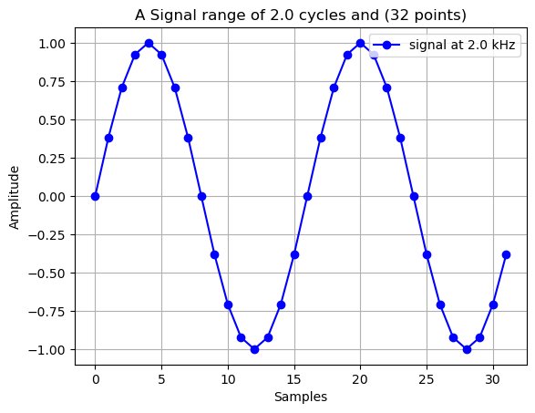
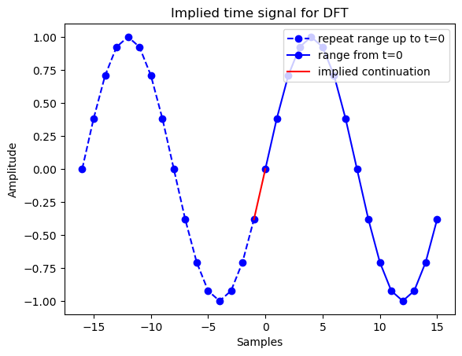
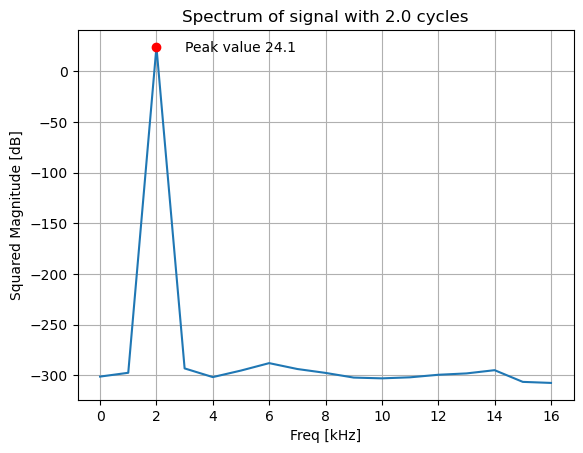
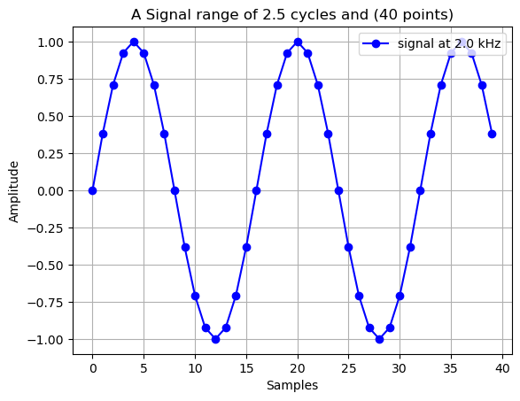
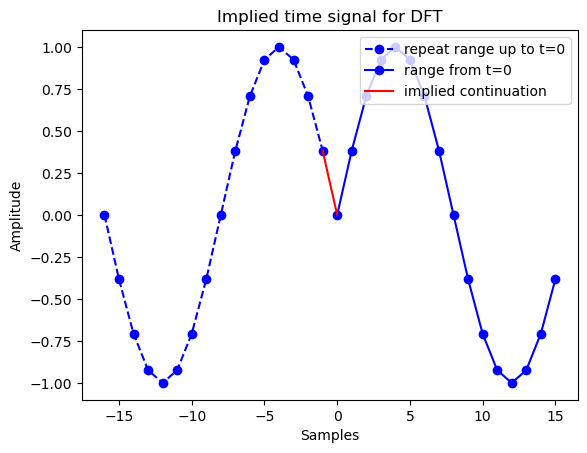
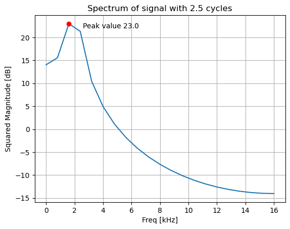
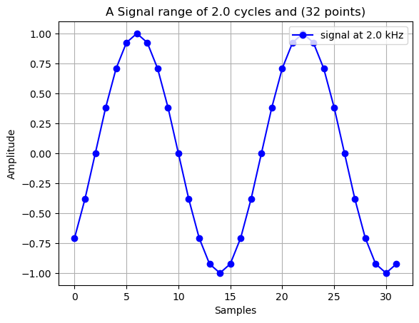
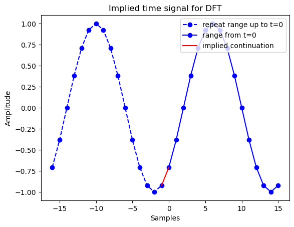

Many people regard the Discrete Fourier Transform (DFT) as an  equivalent view of a discrete time signal, and while that is the case, it is not necessarily exact and it is important to understand that it is only an approximation and why.  The 2 most important considerations are:
- The DFT is derived from only a finite number of time samples (the subject of this post) and
- The DFT results are a power spectral density so the magnitude of the results depends on the original finite BW of the signal and the number of data points in the DFT result.  See *work in progress* DFT Basics 2     [dft-basics-2](2026-10-31-dft-basics-2.md) 

## Effects from the finite sample range
The key point is that the DFT is only ever employed over a finite range of points, while mathematically the underlying transform is an infinite sum.  The consequence is that the resulting spectrum is that of a signal that is the original finite number of samples, but repeated over and over in time. Most significantly, the value of the sample at point at -1 in time is the same value as the last in the sample range and similarly the value after  the last in the range is a repeat of the first point at t=0.  This can lead to a discontinuity in the signal that is not immediately obvious .

The simplest way to demonstrate this is with an exact signal such as a sin wave.  If the signal fits exactly into the finite sample range as in figure 1a, then the resulting DFT figure 1c, is that of a single frequency component as one would expect.  You can see in Figure 1b, where the repeat negative range of the signal is plotted with the first cycle of the positive range, that the implied shape of the waveform at the -1, 0 boundary is smooth and continuous.

|                         Figure 1a                         |                         Figure  1b                          |                        Figure 1c                        |
| :-------------------------------------------------------: | :---------------------------------------------------------: | :-----------------------------------------------------: |
|  |  |  |

However if the signal does not fit into the range exactly as in figure 2a, then the repeat has the implied discontinuity shown in Figure 2b.  This means that the signal that the transform represents is not a simple sin wave, resulting in a distorted DFT as shown in Figure 2c. 

|                           Figure 2a                            |                            Figure 2b                             |                          Figure 2c                           |
| :------------------------------------------------------------: | :--------------------------------------------------------------: | :----------------------------------------------------------: |
|  |  |  |

The distortion around the spectral peak is referred to as spectrum leakage.  Each of the points in the DFT correspond to the correlation of the signal with each k in  sin$(k.pi/N)$ and cos$(k.pi/N)$ where k = 0 to N-1.  The combination of the sin() and cos() correlations give the magnitude and phase of the resulting DFT value.  Each of the the k fractional signal frequencies, often referred to as bins, corresponds to the correlation of the signal with that fractional frequency.  For the signal in Figure 1a, that frequency falls exactly in one bin, hence the single peak in the DFT.  Where as the signal in Figure 2a falls between bins producing partial correlations as well as other components, most notably a DC value, from discontinuity at the join.

it is also worth noting that it is all about any discontinuity between the implied connection between the ends of the signal sample range, and not any discontinuity between the ends and zero.  This can be seen in Figure 3, which is the same signal as in figure 1, but offset in phase by 45 degrees.  The ends seem discontinuous with respect to zero (figure 3a), but the implied join is not, (Figure 3b) and the resulting spectrum (Figure 3c) is the same as in Figure 1c.  Of course Figure 1c only shows the magnitude; the phase of the signals in Figures 1a and 3a are different as are the phases of the resulting DFTs.

|                          Figure 3a                           |                           Figure 3b                            |                        Figure 3c                        |
| :----------------------------------------------------------: | :------------------------------------------------------------: | :-----------------------------------------------------: |
|  |  |  |

## Evaluating the peak value
To understand the peak value, recall that each of the k bins in the DFT result are computed from:

$$
{ X_k = \sum\limits_{n=0}^{N-1} x_n \cdot e^{-j(\cdot 2\pi\cdot k\cdot n/N)} = \sum\limits_{n=0}^{N-1} x_n \cdot (cos(2\pi\cdot k\cdot n/N) - j\cdot sin(2\pi \cdot k \cdot n/N) )}
$$

While the complex exponential expression is the most concise, I include the trigonometric equivalent, because I think it gives a better insight.  For every k, all N signal samples in x, are multiplied by a sin and cos of the fractional frequency $(2\pi \cdot k\cdot n/N)$. This is essentially convolution, the resulting X values are complex with a magnitude and phase given by the real and imaginary parts. Also, each of fractional frequencies is between  $-F_s/2$  and $+F_s/2$ , where $F_s$ is the sampling rate of the time data.

Then, since the time signal is purely real and fits exactly into one of the spectral components  (DFT bin k=2) every point n = 0 to 31, correlates with some combinations of the sin, cos $(2\pi \cdot k\cdot n/32)$ so that sum $\vert X_2\vert = 32/2$ giving a DFT peak as  $10\cdot \log_{10}(16^2) = 24.1dB$. Note that the computation for $\vert X_2\vert$ is N the number of points divided by 2, because the real signal is split into equal magnitude, positive and negative frequency components (bins 2 and 30).

It is quite surprising that for all other values of k there is zero correlation, so the other points on the plot are as low as -300 dB, essentially numerical error in the DFT computation. Also, since the time samples are purely real, with 32 points in the  range, the single sided DFT result shows only the positive half of the spectrum.

## Windowing
In practice of course signals contain many components and are not as simple as Figure 1, so it is impossible to guarantee an exact fit into the transform range.  This is why windowing and other techniques are employed.  Windowing, essentially adjusts values in the sample range so that the end points approach zero and in that way minimises the discontinuity associated with the time repeat overlap.  The taper needs to approach zero, because that is the only way to smooth the discontinuity independent of the phase of the various frequency components of the signal.  

There are various different windowing possibilities with different trade offs.  Clearly, every window changes the input time sample range in some way, so the key is to understand how that is compensated for in the DFT result and whether that is appropriate for the type of signals being transformed.  See *work in progress* DFT Basics 4     [dft-basics-4](2026-10-31-dft-basics-4.md) 

## The order of the DFT result 
One final note about the form of the DFT output.  In this case, the time samples are purely real, the resulting complex DFT spectrum has spectral components at $\pm 2 kHz$, but you may have noticed that while the bin corresponding to 2 kHz is at 2 in the DFT result, the corresponding negative frequency component is at bin 30.   This is due a subtle complication in the implementation of the DFT algorithm.  Not only does this ingenious algorithm reduce the mathematical operations needed to do the DFT calculations, it is also very efficient in memory in that the operations are done *in place*.  That is, the sequence of the calculations is such that the N input time values are gradually overwritten by the N frequency values, without needing any temporary memory locations. 

This bonus feature means that the order of the output array is re-arranged such that the negative half is transposed to the end of the positive half of the array.  So in this case bins 0 to 15 represent 0 to 15 kHz, while bins 16 to 31 represent -16 to -1 kHz respectively.  Hence -2 kHz is in bin 30.  For those who prefer the values in the *natural* order, all FFT libraries provide some function to re-arrange the arrays.  In the Python numpy library, it is fftshift() and this is applied to both the fft() and fftfreq() function outputs to re-order them accordingly.
